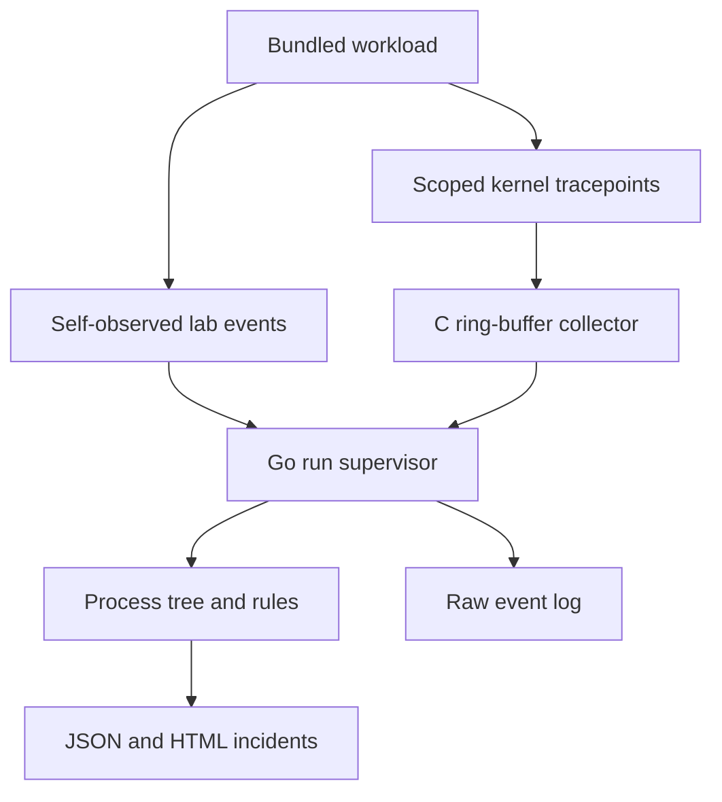

# SyscallWarden

**Status: Runtime detection lab, live validation pending.** The detector, correlation rules and JSON/HTML reporting are tested and verified against the bundled workload below. Kernel-level capture via `make live` has not yet been run on a compatible host — see [Verification status](docs/BENCHMARKS.md#verification-status).

SyscallWarden is a Linux runtime detection lab that traces a shell launch back to a recent successful connection and preserves the relationship in an incident report. Its C probes collect process identities, syscall outcomes and a single environment flag. A Go daemon coordinates the lab and streams evidence to a bounded Python rule engine. Three rules detect a connection followed by a related shell, a successful exec with nonempty `LD_PRELOAD`, and an unapproved ptrace attach or seize request.

## Architecture



Each run has one event source. The full architecture describes the handshake, event fields, scope checks and evidence limits. [Architecture](docs/ARCHITECTURE.md)

## Build and install

After extracting the source archive, run these commands from its parent directory. The Compose build uses Linux containers and Docker Compose v2.15.0 or later with cgroup v2. The first build retrieves the base images and distribution packages. The running lab uses an isolated loopback interface and a shared Unix socket.

```sh
cd syscallwarden
docker compose build
```

The dependency-light test path runs on Linux with Python 3.11+, a C compiler, Linux UAPI headers and Make. On Debian or Kali, the following commands install those prerequisites and run the local suite.

```sh
sudo apt-get install -y python3 build-essential linux-libc-dev
make test
```

For a native development build, install a Go 1.22+ compiler, Clang with a BPF backend and the libbpf development headers. The Dockerfile provides a matching build environment.

```sh
make native daemon-test
go build -o build/warden ./src/daemon
```

## Run the lab and inspect the evidence

```sh
make demo
```

The Go daemon starts the fixed workload after the control handshake. The last line of a successful Compose run gives the directory under `out/demo-…/` containing `events.jsonl`, `incidents.json` and `incidents.html`. Open the HTML locally and expand an incident to see the contributing events. The shell's lineage is listed youngest first.

The following commands reproduce the path exercised for this release on Linux. They launch the same bundled actor as a finite self-test. The witness records completed operations and the ptrace attempt. A missing-file warning on stderr is expected from the loader in the preload case.

```sh
mkdir -p out/witness
python3 lab/workload.py all > out/witness/events.jsonl
python3 src/warden/analyze.py --source lab-witness --out out/witness < out/witness/events.jsonl
python3 lab/verify.py out/witness/incidents.json lab-witness
```

The bundled workload and analyzer produced the following output.

```text
source=lab-witness events=22 SW-001=2 SW-002=1 SW-003=1
PASS lab assertions: 2 related shells, 1 preload marker, 1 attach attempt
```

**Live acceptance step.** On a dedicated Linux lab machine with rootful Docker, a little-endian x86-64 or arm64 kernel, cgroup v2, kernel BTF and tracefs mounted, run the live target.

```sh
make live
```

Use Linux 5.15+ with BPF syscall, tracing, syscall tracepoints, ring buffers, namespace helpers and the required capabilities enabled. The live overlay exposes read-only BTF and tracefs to the sensor and grants BPF and PERFMON. It relaxes the sensor's seccomp profile to allow loading and attachment. The workload keeps the default Docker seccomp profile and zero capabilities. The status line must identify `source=kernel-ringbuf`, the lab assertions must pass, and the collector must report zero loss and incomplete scans. The kernel stream also includes lifecycle events, so its event count may differ from 22. A missing hook, rejected load, filtered ptrace request or mismatched report makes this command fail. The script exports successful reports and removes only its own temporary Compose project.

## Benchmark

| Metric | Measured result | Denominator or interval |
|---|---:|---|
| Detection rate | 100% | 3 of 3 labelled positive witness cases |
| False-positive rate | 16.67% | 1 of 6 labelled benign witness cases |
| Median processing latency | 1.692 µs/event | Validation, correlation and in-memory snapshot |
| p95 processing latency | 2.423 µs/event | 4,400 event timings |
| Live capture latency and loss | Unmeasured | A compatible lab host is required |

One benign health check connected successfully and ran a shell to inspect its own process status. The alert includes both events, and the case label explains why the match is a false positive. [Case-by-case scores and methodology](docs/BENCHMARKS.md)

## How it was built and verified

The C/libbpf collector joins syscall entry data to completion events. The Go daemon checks the control-socket peer, gates the workload on probe readiness, stores raw events, drains the collector and publishes completed reports. The Python detector uses PID and process birth identity, a three-edge ancestor limit and a 1.5-second correlation window. The rules configuration sets shell names and the approved tracer names. The default approved-tracer list is empty. The incident snapshots include syscall evidence without storing complete environments.

The release suite passed 13 tests, including nine independently labelled workload scenarios, C encoder interoperability, native execution of the actual C hook bodies with test stand-ins for kernel helpers, and controls for PID reuse, time boundaries, ancestry and report escaping. The local build environment lacked Docker, a Go toolchain, a Clang BPF compiler, kernel BTF and BPF privileges. The Go binary, BPF ELF, verifier acceptance and Compose runs remain unverified for this release. CI is configured to build both binaries and run the unprivileged Compose demo on a Docker runner. The live acceptance step above remains manual. [Test transcript](docs/evidence/tests.txt) · [Captured report](docs/evidence/incidents.html) · [Run output](docs/evidence/run.txt)

The shell scenario closes its loopback sockets before executing a fixed command. It tests the spawn-chain signal only. The preload fixture names an absent library, and the ptrace fixture requests invalid tracee PID 0. A matched rule supports triage. Establishing a working command channel, a loaded library, or a successful process attachment requires additional evidence. Coverage excludes static `/etc/ld.so.preload` configuration, asynchronous connect completion, compatibility syscalls and arbitrary workload variants. No external payload dataset is required.

## Repository contents

The complete file tree is in [FILE_TREE.txt](docs/FILE_TREE.txt). The project is released under the [MIT license](LICENSE).
