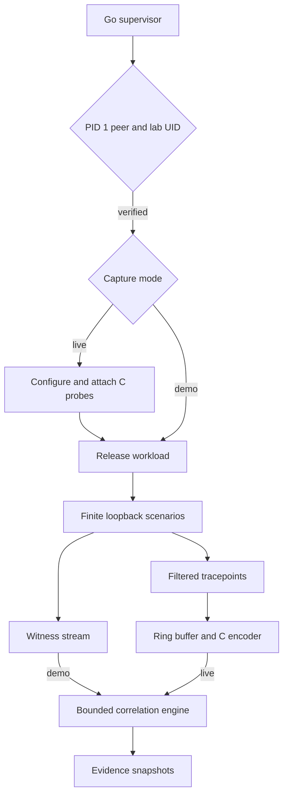

# Architecture

## Process boundaries

The lab and sensor use separate private cgroups and separate network namespaces. Each has only loopback networking. They share the lab's PID namespace and a volume containing one Unix socket. Only the lab mounts that volume writable. The sensor receives peer credentials from the kernel and expects the peer to be PID 1 with UID 65532. The actor reports its cgroup v2 inode. The collector independently checks the PID 1 process name, requires a different cgroup from its own and takes the PID namespace device and inode from its own procfs. The BPF programs check both cgroup ID and PID namespace before reading task or syscall details. No URL, interface, general target PID or host namespace is configurable through the supervisor.

The control protocol is a scope greeting, a start signal, a bounded stream of witness records, an end marker and an acknowledgement. Live mode waits for every probe to attach before it releases the actor. It discards the witness stream and sends only the kernel records to analysis. The supervisor imposes a 90-second deadline, stops the collector after the workload, drains the ring and checks sensor loss counters before publishing reports. PID 1 holds a pidfd for the supervisor and keeps the namespace alive until the supervisor exits.

## Capture and event contract

| Hook | Data retained | Reason |
|---|---|---|
| Raw `sched_process_fork` | Child and parent thread-group IDs and birth timestamps, short process name | Reconstruct intermediate processes and preserve generation identity |
| `sys_enter_execve{,at}` and raw `sched_process_exec` | Requested path, nonempty preload flag, successful exec identity | Only a completed image transition can trigger an exec rule |
| `sys_exit_execve{,at}` and raw `sched_process_exit` | Cleanup of per-thread pending state and leader exit event | Bound state after failures and termination |
| `sys_enter_connect` and `sys_exit_connect` | IPv4/IPv6 address, destination port, signed return value | Rule SW-001 requires a synchronous success |
| `sys_enter_ptrace` | ATTACH or SEIZE operation and requested tracee PID | The alert describes an attempt, including a denied request |

The shared ABI is defined in `src/bpf/wire.h`. The collector validates record size, converts binary addresses with `inet_ntop` and escapes bytes before emitting newline-delimited JSON. Records carry `kind`, `t`, `pid`, `birth`, `ppid`, `pbirth` and `name`. Connect, exec and ptrace records have additional type-specific fields. The JSONL stream has no case labels. The report records its source and schema version. A source label records local provenance and carries no signature.

Kernel timestamps are monotonic nanoseconds. Kernel process IDs are from the initial PID namespace and process birth values are boot-time nanoseconds. The tracee argument is the caller's namespace-local PID. Witness records use observed local PIDs and start ticks from procfs. Their exec time is sampled immediately before the fixed exec and the record is emitted only after the child exits successfully. Treat birth values as opaque within one run. Cross-source identity comparisons or wall-clock timelines require a separate mapping. The witness omits many lifecycle events that the kernel would emit.

## Rule decisions

| Rule | Decision | Evidence in the snapshot |
|---|---|---|
| SW-001 | Recognized shell executes 0 to 1,500 ms after a successful IP connection by itself or one of its first three ancestors | Successful connect, shell exec and generation-qualified lineage |
| SW-002 | Successful exec has a nonempty `LD_PRELOAD` in the scanned prefix | Executed image and presence flag |
| SW-003 | ATTACH or SEIZE from a process whose short name is absent from the approval list | Request number, caller lineage and requested PID |

The detector keeps the latest successful connect per process generation. A failed connect cannot create a positive connection marker. It follows parent identities with a cycle guard and keeps at most 8,192 process entries in observation order. Exit records leave historical lineage available until normal eviction. Up to 1,024 incident snapshots are retained and total rule counters continue after that cap. Reports expose evictions and omitted snapshots. The bounded lab rejects either condition. Admission rejects oversized lines, malformed records, invalid IPs and invalid required fields.

## Operational limits

- An environment scan examines at most 32 native pointers and only the short prefix of each entry. Read errors or exhausting the bound increment a counter. The finite live acceptance run requires all counters to be zero. Paths are bounded to 95 bytes and the requested path can differ from a canonical executable identity.
- A successful blocking connect is observable. An `EINPROGRESS` return is recorded as such. Ancestry can be missing after reparenting, process eviction or a process that predates attachment. Evidence on different CPUs can arrive in a different order from timestamp order. The rule consumes arrival order and rejects negative time differences.
- A fork event is attributed by the current parent task; the bundled actor only forks within its own cgroup and PID namespace. The lab does not delegate cgroups. Security boundaries assume the shipped workload and Compose definitions.
- A name-based approved-tracer list is a local tuning mechanism. Linux process names can change. The default list is empty. Seccomp or another policy may reject a syscall before a syscall tracepoint sees it.
- A preload flag can occur in benign instrumentation and a shell can legitimately follow a network request. These alerts do not establish intent or program compromise.
- Loss from ring reservations, missing exec context, map updates or incomplete environment scans fails the live run. The in-kernel state maps support 1,024 pending exec and connect operations each. No real kernel overhead or loss under pressure was measured here.

## References

Linux kernel documentation describes how libbpf loads and attaches programs and how a shared ring buffer preserves reservation order across CPUs. [libbpf lifecycle](https://docs.kernel.org/bpf/libbpf/libbpf_overview.html) · [BPF ring buffer](https://docs.kernel.org/bpf/ringbuf.html)

The scope check uses two documented kernel helpers. [Current cgroup ID](https://docs.ebpf.io/linux/helper-function/bpf_get_current_cgroup_id/) · [PID namespace helper](https://docs.ebpf.io/linux/helper-function/bpf_get_ns_current_pid_tgid/)
